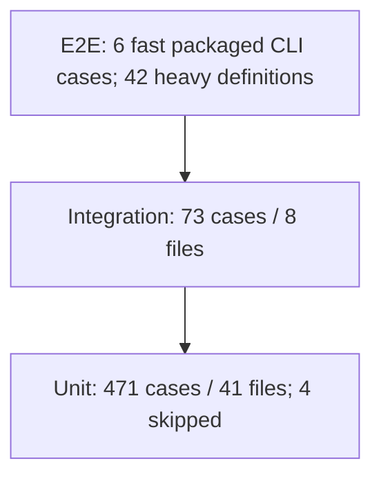

# Automated testing and reports

Status: Approved

## Outcome and boundary

Improve regression detection and make failures explainable across the existing
Unit, Integration and E2E suites. Preserve runtime architecture, upstream MCP
contracts, Codecov, coverage thresholds and all existing required CI checks.
The user confirmed Standard depth with core, operations and security profiles.
Cover every key functional area with automated checks, reusing sufficient existing
tests and adding missing scenarios. Priorities determine delivery order, not which
key features may be omitted. This revision is specification-only: implementation
is paused and requires a new explicit user instruction to resume.
Commits and PR creation are excluded. The user-approved delivery amendment adds
planned public HTML reports on a separate reports-only GitHub Pages site and a
report link in an existing PR. Repository creation, credentials, Pages setup,
public activation and automatic PR comments each require separate authorization;
this specification does not perform or authorize those external actions.

## Verified baseline (2026-10-09)

`npm run test:coverage` on Node 24.20.0 collected 544 cases: 540 passed and four
skipped. Unit: 471 cases in 41 files (467 passed, four skipped); Integration:
73 cases in eight files. The normal packaged CLI E2E suite has six cases using
fake upstream or CLI process checks, not a real Chromium browser.
The distribution collector lists 42 definitions across five manual files:
CDP Node 7, CDP Docker 3, Docker distribution 26, npm distribution 5 and console 1.
Parameterized cases and runtime gates mean these definitions are not equivalent
to an executed-case count. The npm suite expands to six executed cases.

V8 baseline: lines 87.81% (statement percentage was not separately collected), functions 88.92%, branches 80.37%.
Thresholds remain lines/statements/functions 85%, branches 75%.
Coverage measures instrumented source execution, not browser scenario completeness.

## Functional coverage matrix

| Area | Existing evidence | Real Chromium evidence | Gap and priority |
| --- | --- | --- | --- |
| Environment/config/CLI | `env`, `config`, `http-options`, `doctor`, `paths` unit suites | Packaged CLI startup | Trace configuration precedence, validation, engine selection and diagnostics; add uncovered boundaries |
| MCP contracts and local tools | `server` unit, `proxy` integration, packaged CLI fake upstream | npm E2E compares upstream schemas and exercises 25 upstream plus two local tools | Preserve unchanged schemas |
| Navigation, clicks, forms, uploads | npm all-tool scenario; local fixture | npm E2E, both humanize presets | Trace observable outcomes and error paths; real upload/download contents: P0 |
| Profiles/locks/seed | `profile-seed`, `profile-seed-fallback`, `config`, lock cleanup | npm seed restart | Cookies/localStorage restart and cross-profile isolation: P0 |
| MCP transports/session isolation/recovery | `proxy`, `streamable-http`, `http-server`, `sessionStore` | Packaged stdio and CDP manual HTTP cases | Trace stdio and Streamable HTTP, session boundaries, failures and recovery: P0 |
| CDP security/generation/cleanup | Dedicated unit suites; bootstrap/HTTP/WebSocket/TLS/lifecycle integration | Node and Docker manual acceptance | Retain; do not repeat low-level proxy checks |
| Browser proxy | Config passthrough and redaction | No local proxy routing assertion | Deterministic loopback proxy navigation: P1 |
| Humanize | Verified frame-visible loader and weak references | npm default/careful: iframe, new tabs, modifiers, errors, detached-DOM collection | Preserve; do not describe it as mock-only |
| GeoIP | Injected config tests | No live GeoIP resolution proof | P1: controlled DB/service fixture and observable launch configuration; required in this delivery |
| Extensions | Config/command construction | No installed-extension behavior proof | P1: actual extension attachment and failure/reconnection checks; required in this delivery |
| Lifecycle/resources | Unit/integration failure and shutdown assertions | CDP browser rotation and Docker Xvfb cleanup | Concurrency, successful/failed startup, shutdown and bounded repeated-cycle cleanup: P0 |
| Platforms | Quality matrix: five runners, Node 22/24/25/26; coverage and Codecov | Existing console/CDP/Docker jobs | Required supported-platform/package/container evidence: P1; host run alone is insufficient |
| Reporting | Console/V8/lcov, ad hoc Markdown reports | None | P0: private structured results, history and HTML |

Fixed delays used as navigation survival probes are intentional, not readiness
signals. New tests wait for observable state or bounded polling. Existing network
downloads and Docker pulls remain possible infrastructure failures. Do not hide
them through retries or lower assertions. Existing unit/integration overlap at
protocol boundaries is retained unless two cases demonstrably guard the same risk.

## Reporting alternatives and decision

| Option | Evidence | Decision |
| --- | --- | --- |
| Official `allure-vitest` 3.13.0 + Vitest 5.0.1 | Isolated pass/fail/skip probe executes tests but writes zero results; adapter reads removed `test.task`; runner 5 is not published | Rejected for this installed runner; no downgrade |
| Vitest HTML reporter | Useful local failure view; would require matching UI package; less suitable for cross-job history and attachments | Alternative, not selected |
| Native JUnit/JSON only | Stable machine output; limited integrated diagnostics/history UI | Useful interchange, insufficient alone |
| Allure Report 3 + public Vitest Reporter API | Allure consumes standard result JSON; public test/module results expose errors, timing, retry count and artifacts | Selected subject to success/failure/HTML validation |

Allure CLI 3.20.1 was checked in official npm metadata. An integration must use
public Vitest APIs and standard Allure results, not private task fields. Historical
launches and retry diagnostics must remain distinguishable from environment variants.
Sources: [Allure Vitest adapter](https://github.com/allure-framework/allure-js/blob/main/packages/allure-vitest/src/reporter.ts),
[Allure 3](https://allurereport.org/docs/v3/),
[Vitest 5](https://vitest.dev/blog/vitest-5).

## Requirements and acceptance

### TEST-001: Honest inventory and coverage

Maintain a testing pyramid, feature/scenario matrix, risk backlog, strategy and
actual run evidence. Distinguish collection, execution, skipped cases, fake upstream
and real browsers; never treat covered source lines as functional browser coverage.
Acceptance: counts derive from runner output, include skips and environment limits;
the final report records new tests, remaining gaps and unchanged thresholds.
Inventory explicitly assesses duplicates and potential flakes in existing suites,
explains retained overlap, and prioritizes missing scenarios by regression risk.
Every key area has explicit scenario-to-test traceability under TEST-011. A missing
key check remains incomplete work; it cannot be moved out of scope by assigning P2.

### TEST-002: Require all application tests before merge

User-approved amendment (2026-10-13): all application suites are required PR gates.
Run unit/integration and packaged CLI across five native platforms and Node
22/24/25/26. Collect Ubuntu x64 coverage in the main execution, preserving Codecov
and thresholds. Run console/CDP and npm, proxy/GeoIP, extensions and lifecycle
suites in parallel native matrices; retain Docker amd64/arm64 acceptance.
The same workflow supports weekly and manual runs; remove duplicated suite jobs
and post-release application tests. Release jobs build, validate artifact metadata
and publish. All suites emit compatible reports.
Acceptance: required-ci fails for failed, cancelled, skipped or missing mandatory
jobs, including functional suites and report aggregation; producer inventory
matches the matrices; failed tests retain nonzero status. Publication itself is
not a merge requirement, and no branch-protection changes are authorized.

### TEST-003: Persist and isolate browser state

Through the installed npm package and a local HTTP origin, store a cookie and
localStorage value in an explicit profile, restart the bridge and observe both.
A second profile must expose neither value. Verify the original seed remains stable.
Acceptance: first profile restores both values; second returns absence via cookie
and localStorage reads; profile/process/fixture resources are cleaned on all paths.

### TEST-004: Verify downloaded content

Use the installed package and real Chromium to navigate to a local page, activate a
download and inspect its saved bytes in the temporary output directory. Preserve
existing clicks/forms/uploads, navigation survival and `browser_find.filename` tests.
Acceptance: the expected filename and exact controlled content are observed; merely
invoking a tool or receiving a successful MCP response does not establish success.

### TEST-005: Verify actual proxy routing

Navigate real Chromium through a local browser proxy fixture and prove the fixture
handled the origin request. Exercise an unavailable proxy as an expected error and
verify later successful navigation using a clean runtime. Avoid public proxy services.
Acceptance: fixture records the controlled request, local content is visible, the
negative call reports an explicit error and recovery succeeds; all sockets close.

### TEST-006: Complete structured test evidence

Produce status, duration, failure messages and stack traces for every completed test
at every level. Record skipped tests, suite/collection failures and unhandled runner
errors rather than silently dropping them. Group by feature, level, OS, architecture,
Node major and execution lane. Preserve stable identity across runs and separate
environment variants. Record retry count/flaky status and previous-launch history.
Acceptance: a controlled pass/fail/skip/retry fixture produces the matching results;
an import failure is visible; repeated launches produce history; zero results or
incompatible reporter behavior is an explicit failure, not an empty successful report.

### TEST-007: Safe diagnostics and attachments

Attach bounded failure logs, process diagnostics and fixture screenshots to E2E
where available. Capture screenshots only from controlled local test content.
Redact credentials, bearer tokens, secret environment values, proxy userinfo and CDP
capability URLs before result persistence and again before artifact/report generation.
Do not dump the environment, arbitrary profile files or remote-page screenshots.
Acceptance: synthetic secrets are absent from JSON, text attachments, HTML and Job
Summary; diagnostic evidence remains useful; unsafe attachment paths/symlinks and
unsupported binaries are rejected; tests write only cleaned temporary fixture data.
Public HTML, PR comments and their summaries obey the same redaction guarantees.
PR-produced artifacts are untrusted: publication must not execute PR code or
publish PR-supplied HTML, JavaScript, configuration or arbitrary assets. Regenerate
public output using trusted pinned tooling and controlled assets after validation.
Acceptance: malicious artifact paths, executable content and synthetic secret
canaries are rejected before publication; no unsafe bytes reach the public tree.

### TEST-008: Local generation and history

Offer documented commands to collect tests, generate HTML and open it locally.
Keep generated results/report/history out of the source repository's Git history
and npm distribution. Only the dedicated reports repository may version sanitized
generated public HTML after separately authorized activation. Normal runs
start with a separate results namespace; intentional reruns/history remain supported.
Acceptance: HTML opens from generated files without an external service or Java;
repeat generation preserves history and does not invent repeated test attempts.

### TEST-009: CI aggregation, separate Pages delivery and PR links

Upload sanitized results and generated HTML as GitHub Actions artifacts on success
and failure, with bounded retention and read-only permissions. Merge parallel job
results without overwriting UUID files or conflating environment variants. Emit
counts, duration and failure/missing-job evidence in Job Summary. Historical data
is reused only from the same trusted lane; fork PRs must not poison trusted history.
Acceptance: a local multi-job merge retains all cases and attachments; CI uses
`always()` for reporting but never converts test failure to success; no raw results
are uploaded; missing producer output is stated explicitly; Codecov remains intact.

After separately authorized activation, publish one combined report per CI run
for the expected Linux/macOS/Windows and Node matrix, retaining every environment
variant and explicitly identifying missing producers. Use Allure Report 3 for
generation and `peaceiris/actions-gh-pages` for static publication. Project-owned
trusted publication code renders statistics and the deployed report link in the
PR comment and Job Summary. `allure-framework/allure-action` is not a required
delivery component: its marker-only comment updates do not establish ownership.
Select supported Action releases and verify full commit SHA pins before use.
These selected components do not relax any publication or freshness guard.

The destination is an independent reports-only project Pages repository; proposed
identity `swimmwatch/cloakbrowser-mcp-reports` requires exact confirmation before
external setup. Preserve the source `swimmwatch/cloakbrowser-mcp` documentation
site, its deployment, `site/` output and Pages settings. A separate branch in the
source repository is not a second independent site. Separate project Pages sites
may share an origin; repository separation does not imply browser-origin isolation.
The reports repository uses branch-based Pages from `gh-pages` at its root.
Reports have immutable `pr/<number>/run/<id>-attempt-<attempt>/<sha>/` paths.
Keep reports for 14 days; remove only expired owned report paths, preserving other
PRs, live runs and unrelated files. Keep sanitized Actions artifacts as a fallback.

Only trusted default-branch publication code may handle untrusted result artifacts.
Derive destination, PR and run identity from GitHub's API, validate results and
regenerate HTML before writing. Test producers remain read-only. Use short-lived
credentials limited to the reports repository for publication; grant comment/check
permissions only where required in the trusted publisher. Never grant source
documentation Pages or source contents-write permissions for this delivery.
PR/fork reports must not update trusted default-branch history. Serialize destination
writes and cleanup; repeated events must not duplicate reports or comments.

Verify successful deployment and the exact report URL before linking. Recheck the
current PR head and latest eligible CI run immediately before updating one bot-owned
comment and the publisher Job Summary. Include tested SHA, status counts and
incomplete/environment-failure evidence. Old SHA/run/attempt results must not replace
a newer link. A failed test still has a truthful report; missing results or failed
publication must show an unavailable/incomplete state, never a broken success link.
Identify the comment by its fixed marker and verified bot author; a user comment
containing the same marker must never be updated or deleted by the publisher.
Acceptance: merged matrix results remain individually identifiable; authorized
live proof opens the matching report from the PR link and confirms the documentation
site is intact. Controlled stale-run, malicious-artifact, duplicate-event and
fixed-clock retention checks reject wrong-target writes, stale link replacement,
unsafe output and deletion of live/unrelated content. Disabling only the report
publisher preserves documentation deployment and sanitized artifact access.

### TEST-010: Platform and lifecycle compatibility

Preserve runtime Node `^22.13.0 || >=24.0.0` and Linux/macOS/Windows support;
test tooling obeys installed Vitest's supported Node versions. Keep Vitest 5;
do not downgrade it or patch private adapter APIs for reporting. Retain Docker Linux
amd64/arm64 verification and pinned official base. Use portable paths/process
launching, loopback ephemeral ports, Free Chromium and isolated caches. Do not kill
unrelated processes or use saved license credentials. Release image/version blockers
remain separate; old Docker evidence does not prove npm MCP 0.0.83 compatibility.
Acceptance: host checks pass, CI matrix remains configured, fixture cleanup is
asserted, and unexecuted platforms/Docker checks are explicitly reported as unverified.

### TEST-011: Automated checks for all key functionality

Maintain executable checks for every row below. Retain sufficient existing tests;
add tests only where outcomes, error handling or lifecycle boundaries are missing.
The final coverage matrix names the test, level, environment and actual result for
each scenario. Mock/fake-upstream evidence must remain distinguishable from real
browser evidence.

| Key area | Required observable scenarios |
| --- | --- |
| CLI and configuration | Help/version/doctor, documented CLI/environment precedence, invalid configuration, supported engine selection and startup failure diagnostics |
| MCP contracts and tools | Compare the actual upstream `listTools` schemas unchanged; exercise every standard tool and both local tools with valid inputs and applicable invalid-input/error paths; verify effects rather than only a successful response |
| Browser automation | Navigation/back/tabs, snapshot and find/file output, clicks/hover/drag/drop, keyboard/modifiers, forms and special inputs, dialogs, iframe interactions, screenshot, console/network inspection, actual upload and downloaded bytes, closed-page/navigation error and recovery |
| Profiles and session state | Seed persistence and overrides, profile locking and failure cleanup, cookie/localStorage restart persistence, independent persistent profiles and temporary-session isolation |
| MCP transports | Packaged stdio protocol purity, Streamable HTTP session initialization/isolation, invalid or expired sessions, upstream errors/disconnection, cancellation and graceful/failed shutdown according to the existing contracts |
| CDP | Real HTTP/WebSocket browser access and shared state, isolated concurrent sessions, existing authentication/capability/origin/TLS boundaries, generation rotation, upstream failure and cleanup |
| Proxy | Actual routing for supported proxy modes, credential handling/redaction, bypass behavior, unavailable proxy error and recovery; preserve the documented limitations of browser-flag proxying for request APIs |
| Extensions | Attachment through the existing extension mode to a controlled real browser, observable browser action, documented token/pairing rejection, disconnection and supported recovery; configuration mocks alone are insufficient |
| Humanization | Both presets, existing/new tabs, iframe visibility, complex/ambiguous locators, special fields, modifiers, MCP error propagation and detached-DOM cleanup with real browser outcomes |
| GeoIP | Controlled proxy-location lookup, observable timezone/language/locale launch configuration, disabled matching, explicit overrides and documented lookup failure/fallback behavior; no public GeoIP service dependency |
| Concurrency and resources | Concurrent independent sessions and cold-cache download, lock contention, successful/failed startup and repeated shutdown, removal of owned temporary resources, termination of owned children and closure of sockets/ports after success and failure |
| Distribution and compatibility | Installed npm entrypoint, existing Docker entrypoint/build/smoke/parity, supported Linux/macOS/Windows and Node versions, Linux amd64/arm64 Docker; identify actual browser and MCP versions and unsupported combinations explicitly |

Acceptance: every applicable key scenario is linked to an executable automated
check and an observed assertion. Browser-facing behavior uses real Chromium and
controlled local fixtures; parser/config/security boundaries may use unit or
integration tests. Negative checks assert the expected error and resulting state.
Tests own and clean up their resources on success and failure. A successful tool
response, source coverage percentage, configured CI job or fake upstream cannot
substitute for a required real-browser observation. Unexecuted scenarios remain
unverified; unavailable environments or demonstrated capability constraints are
reported as blockers with evidence, not silently skipped or described as passed.
Deferring a key scenario requires an explicit user scope decision.

## Prioritized backlog and acceptance

| Priority | Work | Completion observation |
| --- | --- | --- |
| P0 | Safe reporter, merge, summary, HTML/history and success/failure probes | TEST-006 through TEST-009 validated without losing failing exit status |
| P0 | Cookie/localStorage restart and independent profile isolation | TEST-003 passes against installed npm package |
| P0 | Real download bytes | TEST-004 passes against local server |
| P0 | Complete key browser, tool, transport, CDP, configuration and lifecycle coverage | TEST-011 scenario matrix has observable assertions and reuses existing sufficient checks |
| P1 | Real proxy routing, expected failure and recovery | TEST-005 passes without external services |
| P1 | Required PR browser matrices, weekly/manual reuse and CI aggregation | TEST-002/009 configured; host verification plus workflow lint |
| P1 | Real extension attachment, failure and supported recovery | TEST-011 extension scenarios pass with a controlled real browser |
| P1 | GeoIP controlled database/service checks | TEST-011 GeoIP outcomes and failure/fallback behavior are asserted deterministically |
| P1 | Supported platform, Node and Docker verification | TEST-010/011 have actual environment evidence; unavailable checks remain blockers |
| P2 | Long-duration resource trend sampling and additional non-key combinations | Supplemental depth; bounded repeated-cycle cleanup and all key scenarios remain mandatory |

P0/P1 and every key scenario in TEST-011 are required for the planned delivery.
P2 is supplemental depth and does not defer extensions, GeoIP, platform support or
basic resource-leak checks. Resource checks observe actual cleanup/closed handles
across bounded repeated cycles; a single heap snapshot does not prove memory safety.

## Validation

Run typecheck, lint, unit, integration, normal E2E, new real Chromium npm E2E,
coverage, package verification, reporting pass/fail/import-error/merge/history
probes, HTML generation, docs build/SEO/translations and `npm run check`.
After workflow edits run actionlint and zizmor. Record exact counts, coverage and
unavailable checks, plus the complete TEST-011 scenario-to-test matrix. Key gaps
block completion unless the user explicitly changes scope. Never weaken checks,
change upstream contracts, bump the release
version, create commits or activate external publication without separate authorization.
